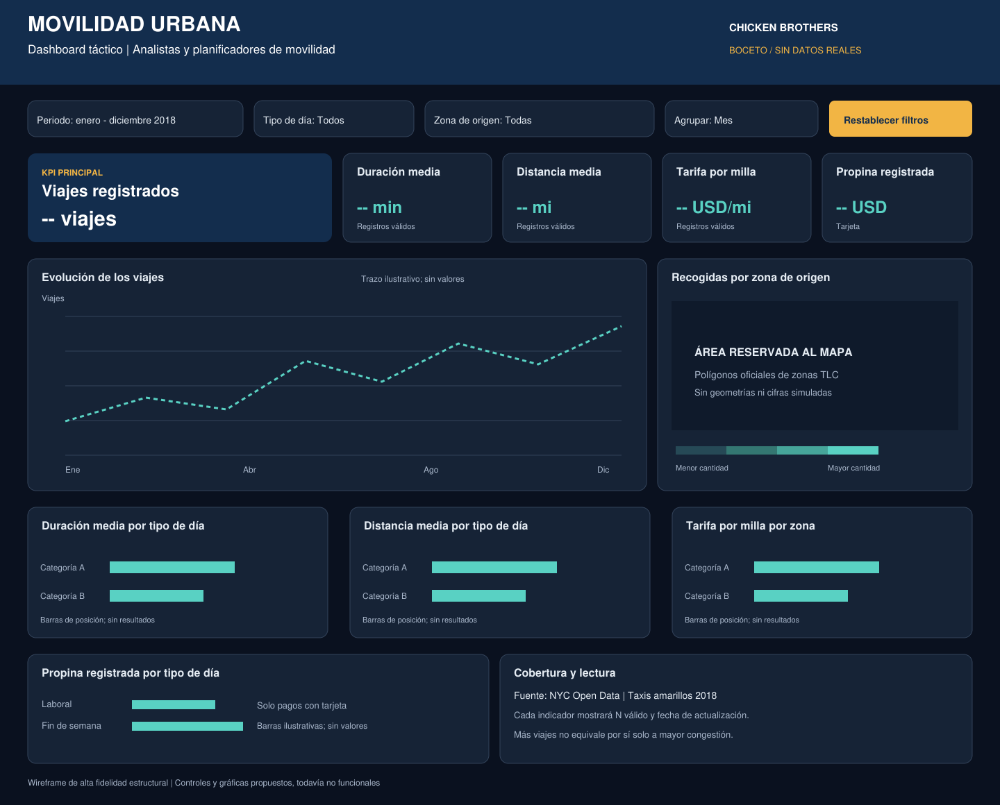
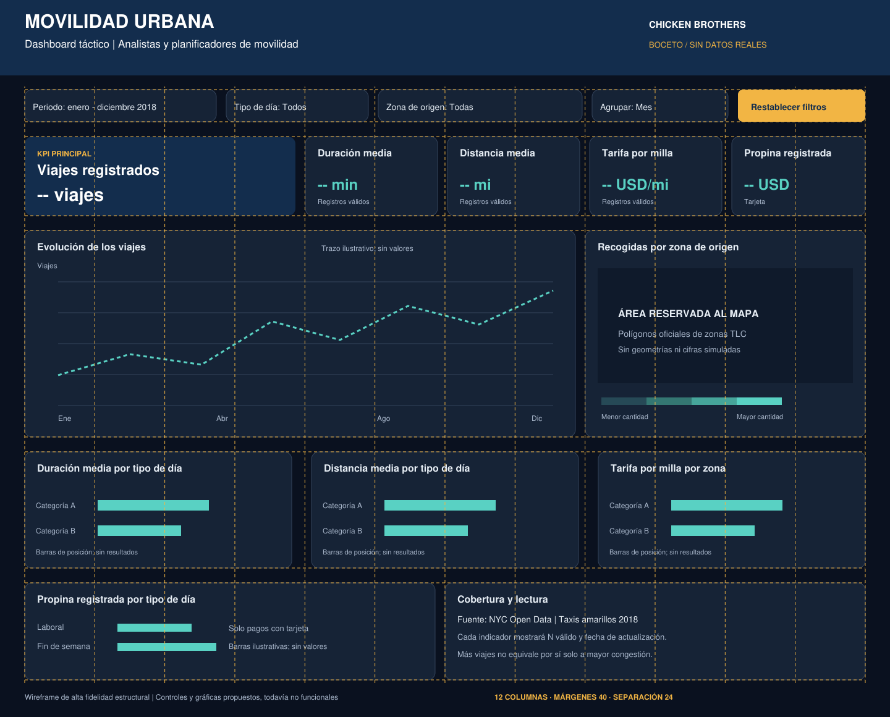

# Fase 2: Diseño visual del dashboard táctico

**Proyecto 4:** La movilidad urbana y el tráfico inteligente  
**Equipo:** Chicken Brothers  
**Integrantes:** Edgar Antonio Perez Flores · Julio Cesar Paredes Arceo  
**Fecha del documento original:** 10 de noviembre de 2026.

Versión Markdown del [documento original en PDF](Fase_2_Diseno_Dashboard.pdf).

> **Nota de evolución del proyecto:** se conserva el planteamiento de esta fase. En la implementación se delimitó el análisis a enero-abril de 2018 por el almacenamiento requerido por archivos, base de datos e índices en Codespaces. Se utilizaron cuatro archivos mensuales completos de NYC TLC en Parquet, con 35,991,011 registros de origen; no es una muestra aleatoria. El estado implementado, las pruebas y las diferencias respecto al plan se documentan en la [Fase 3](Fase_3_Implementacion.md).

## 1. Audiencia y pregunta central

El dashboard se dirigirá exclusivamente a analistas y planificadores de movilidad. Se elimina el perfil de responsables de operaciones de taxis. Los usuarios explorarán patrones mensuales, diarios y horarios para identificar dónde y cuándo se concentra la demanda observada y contextualizarla mediante duración, distancia y costos.

Pregunta central: ¿Cómo se distribuyen los viajes de taxis amarillos de Nueva York durante 2018 por periodo y zona de origen, y qué características presentan los recorridos en esas zonas y horarios?

El enfoque será táctico: facilitar comparaciones históricas que apoyen la planificación a medio plazo. La pantalla no representará monitoreo en tiempo real. El volumen de viajes no demuestra congestión por sí solo ni representa todos los medios de transporte de la ciudad.

## 2. KPI principal: viajes registrados

Definición: número de registros de viaje incluidos en el periodo seleccionado después de validar la fecha de inicio en 2018 y aplicar los filtros activos. Unidad: viajes. No se usará un conteo distinto de una combinación de campos como sustituto de un identificador único.

Justificación: responde directamente dónde y cuándo se concentra la actividad observada. Permite comparar zonas y periodos, identificar concentraciones de recogidas y orientar análisis territoriales. Por ello será la tarjeta más grande y se explicará mediante una serie temporal y un mapa.

Los registros con zona desconocida podrán contribuir al total temporal, pero se informará cuántos se excluyen del mapa. Se mostrarán días cubiertos para evitar interpretar un periodo incompleto como menor actividad.

## 3. Alcance del diseño

Esta entrega contiene la selección de KPIs, las visualizaciones justificadas, la paleta, el wireframe y la cuadrícula. Los valores se presentan como guiones; los trazos son ilustrativos. No se ha cargado el conjunto completo ni implementado el dashboard.

## 4. KPIs complementarios y visualizaciones

| KPI y cálculo | Visualización | Justificación |
| --- | --- | --- |
| Viajes registrados: conteo válido para el periodo. | Tarjeta destacada, línea por mes/día/hora y mapa por zona. | Resumir volumen y distribución temporal y espacial. |
| Duración media: media de fin-inicio en minutos; positiva y válida. | Tarjeta y barras por tipo de día. | Comparar duración entre lunes-viernes y fines de semana. |
| Distancia media: media de trip_distance positiva válida, en millas. | Tarjeta y barras por tipo de día. | Contextualizar duración con longitud del recorrido. |
| Tarifa por milla: SUM(fare_amount) / SUM(trip_distance), mismo conjunto con distancia positiva y tarifa no negativa. | Tarjeta y barras horizontales de las 7 zonas con mayor cociente. | Comparar costo unitario; mostrar N y distancia acumulada para interpretar inestabilidad. |
| Propina registrada media: media de tip_amount en pagos con tarjeta; incluye ceros, excluye faltantes y negativos observados. | Tarjeta y barras por tipo de día. | Contexto económico; las propinas en efectivo no se registran en este campo. |

Cada tarjeta tendrá su propio N válido: los faltantes de distancia no eliminarán automáticamente un viaje del conteo principal. Las métricas monetarias se expresarán en USD. No se denominará “promedio simple de tarifas por milla” al cociente de sumas.

Las líneas se reservarán para tiempo; las barras para categorías. No se usará pastel para zonas por su cantidad y dificultad de comparación. El mapa usará conteos por zona, no densidad por superficie. Las categorías del boceto son marcadores de posición, no zonas ni resultados reales.

## 5. Armonía estética y accesibilidad

| Color | Uso previsto |
| --- | --- |
| Azul noche · #0B1220 | Fondo general y encabezado. |
| Gris azulado · #172337 | Superficies de tarjetas, filtros y gráficos. |
| Turquesa · #5AD1C4 | Líneas, barras y valores principales. |
| Ámbar · #F2B544 | Acentos, foco, acciones y selección; referencia a taxis amarillos. |

Los cuatro colores principales se complementan con texto claro #E6EDF5, texto secundario #AAB8CC y bordes #34445B. Estos neutros sirven a la legibilidad. La tarjeta principal utilizará un tinte azul más claro y una etiqueta ámbar; la distinción no dependerá solo del color.

Contraste calculado sobre tarjetas #172337: texto claro 13.4:1; texto secundario 7.8:1; turquesa 8.5:1. En botones ámbar se usará texto azul noche (10.2:1). Los valores se verificarán de nuevo en la implementación y no equivalen a una auditoría completa de accesibilidad. Se incluirán etiquetas y contornos de foco, evitando depender de rojo frente a verde.

El mapa usará una escala secuencial de turquesas de menor a mayor luminosidad sobre un fondo oscuro, con límites visibles y leyenda textual. Los registros sin datos se distinguirán en gris; no se confundirán con cero viajes. La versión oscura se aplica a la interfaz y a los bocetos; el reporte conserva fondo blanco para lectura e impresión.

Tipografía: sans serif; Inter si está disponible, con Arial como alternativa. Título de 30 px, valor principal de 32 px, títulos de gráficas de 16-18 px y etiquetas de 12-14 px. El texto explicativo será breve y alineado a la izquierda; números y unidades tendrán formato uniforme.

Estilo: tarjetas oscuras, borde fino, radio de 12 px y espacio interior de 20 px. Se evitarán efectos 3D, gradientes decorativos y sombras fuertes. La línea temporal no llevará relleno para reducir ruido visual.

## 6. Filtros e interacciones previstas

Filtros globales: periodo dentro de 2018, tipo de día (todos, lunes a viernes, sábado y domingo) y zona de origen. Lunes a viernes no distinguirá feriados en esta versión. La opción mes/día/hora cambiará la agrupación de la serie. Restablecer devolverá todos los filtros al alcance inicial.

Seleccionar una zona en el mapa actualizará los KPIs y gráficas, con una etiqueta visible de selección. Las ayudas mostrarán unidad, definición, N válido y periodo. Se contemplarán estados de carga, error con reintento y “sin datos para los filtros seleccionados”; un valor ausente se mostrará como guion, nunca como cero.

## 7. Wireframe: estructura visual propuesta

Lectura: título y filtros arriba; tarjeta principal de doble ancho frente a las secundarias; serie temporal dominante junto al mapa; comparaciones secundarias y cobertura en la parte inferior. Todas las cifras están pendientes de cálculo.

La vista completa usa un lienzo de referencia de 1440 × 1160 px. En pantallas de menor altura habrá desplazamiento vertical; no se reducirá la tipografía para comprimir todo en una sola pantalla. El mapa se deja reservado hasta integrar polígonos oficiales.

Prioridades visuales

Nivel 1: título y KPI principal, con mayor tamaño y contraste. Nivel 2: evolución temporal y mapa, que explican el volumen de viajes. Nivel 3: KPIs secundarios, comparaciones, leyendas y cobertura. Los filtros permanecen visibles y próximos al título.

[Wireframe en PDF](../design/Wireframe.pdf)

## 8. Cuadrícula y adaptación

Se propone una cuadrícula de 12 columnas, márgenes laterales de 40 px y separación vertical de 24 px. KPI principal: 4 columnas; cada secundario: 2. Serie temporal: 8; mapa: 4. Tres comparaciones: 4 columnas cada una. Propinas y cobertura: 6 columnas cada bloque. Las líneas ámbar muestran guías y no se verán en el dashboard final.

Alturas aproximadas: encabezado 122 px; filtros 52; tarjetas 128; gráficos principales 334; comparaciones 188; bloque inferior 157. En tablet se usará una cuadrícula de 6 columnas y en móvil una columna, conservando el orden de prioridad. Filtros y tarjetas se apilarán sin desplazamiento horizontal.

[Cuadrícula en PDF](../design/Cuadricula.pdf)

## 9. Aplicación de la metodología de referencia

Se toma como guía el material de Jessica Mendiola, Metodología para la creación de un panel de control (Visualización, primavera 2023), especialmente estructura, wireframe, cuadrícula, patrón Z, modos push/pull y principios Gestalt. La rúbrica específica de la Fase 2 determina los entregables.

Caracterización: audiencia única de analistas y planificadores; alcance específico en taxis amarillos de Nueva York; datos cuantitativos de viajes y costos, categorías de zona y tipo de día; tiempo histórico (2018); diseño interactivo y exploratorio. Se conserva la clasificación táctica solicitada. El material también describe dashboards analíticos: aquí el análisis histórico apoya decisiones tácticas, sin cambiar el nombre del proyecto.

| Pregunta | Columnas y operación |
| --- | --- |
| ¿Cuándo y dónde se concentran los viajes? | tpep_pickup_datetime + PULocationID; conteo por tiempo y zona. |
| ¿Cuánto duran y qué distancia recorren? | Fechas de inicio/fin: diferencia y media; trip_distance: media. |
| ¿Cómo cambia el costo por zona? | fare_amount y trip_distance: cociente de sumas del mismo subconjunto válido. |
| ¿Qué propina se registra por tipo de día? | tip_amount, payment_type y fecha: filtrar tarjeta, agrupar y promediar. |

Patrón Z y centro: el título y KPI principal ocupan la esquina superior izquierda; el recorrido continúa por las tarjetas y conduce a la evolución temporal central, al mapa y a los detalles inferiores. Es una guía de composición, no una regla rígida sobre cómo miran todos los usuarios.

Push: la vista inicial comunica volumen, periodo y distribución sin interacción. Pull: los filtros y la selección de zonas permiten investigar; se mantienen visibles el contexto y las unidades.

Gestalt: proximidad para reunir métricas relacionadas; semejanza en tarjetas y colores de datos; cierre mediante contenedores y pocos bordes; continuidad mediante alineación y orden temporal. Se eliminan adornos que no contribuyan a la pregunta central.

Las barras comparativas se limitarán a siete zonas visibles y se ordenarán por valor. La línea tendrá una sola serie con meses ordenados; los puntos temporales no se recortarán a cinco, pues ello perdería el contexto anual. Se ofrecen bocetos de alta fidelidad: color y estilo definidos, sin resultados reales ni interacción implementada.

## 10. Trabajo en la nube

La documentación y los bocetos se conservarán en el repositorio público EdgarAntonioPerezFlores/Movilidad-Urbana. Para esta fase no hace falta descargar el CSV ni instalar una base de datos en la computadora de los integrantes.

Arquitectura prevista para una fase posterior: un proceso de carga en un entorno remoto obtendrá el conjunto t29m-gskq por lotes y conservará avances; PostgreSQL en la nube almacenará los registros y resúmenes; una API entregará agregados al dashboard React. Las credenciales se gestionarán en el servidor y no en el repositorio público ni en el navegador.

Antes de contratar o aprovisionar infraestructura se medirá tamaño real, almacenamiento de índices, tiempo de carga y costo. No se supone que un plan gratuito admita todo el conjunto. Se comprobará que la paginación sea estable, que el origen no cambie durante la extracción y que los conteos coincidan. Las alternativas oficiales se evaluarán si el portal falla, sin sustituir silenciosamente la fuente elegida.

Estado: se entrega el diseño documental en la nube mediante GitHub. No se ha creado una base de datos remota, contratado servicios ni desplegado una aplicación funcional. Esas tareas corresponden a la implementación posterior.

## 11. Correspondencia con la rúbrica

| Requisito | Evidencia |
| --- | --- |
| KPI principal (20 puntos) | Sección 2: definición, pregunta central y justificación. |
| Tipos de gráficos (20 puntos) | Sección 4: KPI principal y cuatro secundarios; cálculo, gráfico y justificación. |
| Paleta y coherencia (20 puntos) | Sección 5: colores, funciones, contraste y estilo. |
| Wireframe (30 puntos) | Secciones 7 y 8: pantalla, filtros, leyendas, cuadrícula y jerarquía. |
| Presentación (10 puntos) | Documento organizado, bocetos legibles y alcance declarado. |

## Referencias de trabajo

Jessica Mendiola. Metodología para la creación de un panel de control. Visualización, primavera 2023 (PDF proporcionado). Indicaciones fase 2.pdf, proporcionado por el docente: actividades y criterios de evaluación. Fase 1 del proyecto Movilidad-Urbana: alcance y variables. NYC Open Data: conjunto 2018 Yellow Taxi Trip Data, identificador t29m-gskq. TLC: diccionario Yellow Taxi Trip Records y catálogo de zonas; se validarán los códigos aplicables a 2018 al implementar.

Fuente del dataset · Repositorio del proyecto

## Enlaces de consulta

- [https://data.cityofnewyork.us/Transportation/2018-Yellow-Taxi-Trip-Data/t29m-gskq/about_data](https://data.cityofnewyork.us/Transportation/2018-Yellow-Taxi-Trip-Data/t29m-gskq/about_data)
- [https://github.com/EdgarAntonioPerezFlores/Movilidad-Urbana](https://github.com/EdgarAntonioPerezFlores/Movilidad-Urbana)
