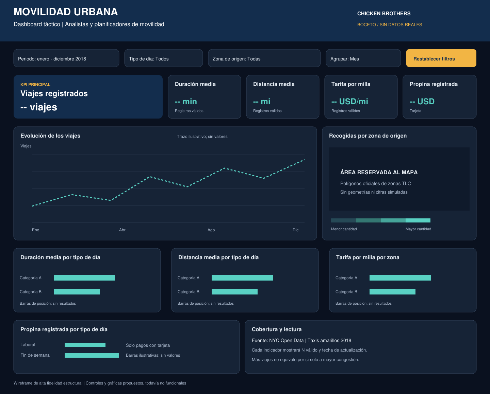
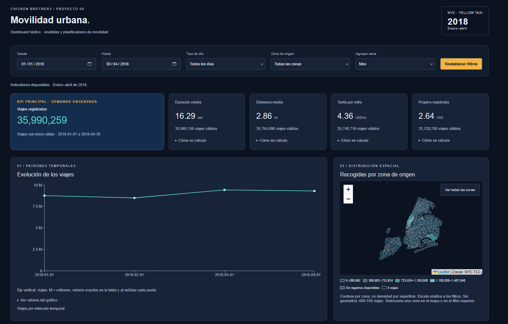
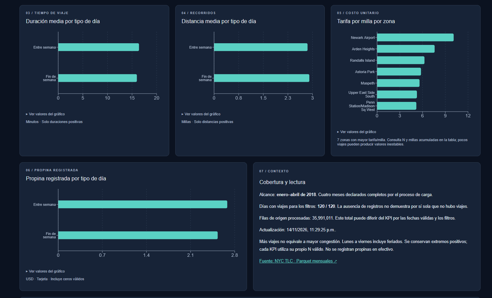
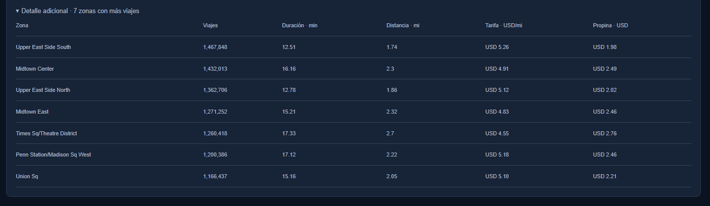

# Fase 3: implementación del dashboard táctico

**Chicken Brothers**  
Edgar Antonio Perez Flores · Julio Cesar Paredes Arceo  
**Alcance acordado:** enero a abril de 2018.  
**Audiencia:** analistas y planificadores de movilidad.

## Introducción

El dashboard transforma el wireframe de Fase 2 en una aplicación React para explorar demanda observada, duración, distancia, tarifas y propinas. La decisión de limitarse a cuatro meses sustituye el alcance anual del diseño original; no cambia la audiencia ni el enfoque táctico. El volumen de viajes no mide directamente congestión ni representa toda la movilidad de NYC.

Esta revisión conserva el orden visual y los indicadores; completa el mapa y las barras de tarifa que faltaban. El resultado se publica como código en GitHub para ejecutarse contra PostgreSQL en el Codespace del equipo. No se ha publicado un nuevo alojamiento permanente ni se han vuelto a importar los viajes.

## Justificación de la delimitación temporal

Se redujo el periodo de análisis de todo 2018 a enero-abril para limitar el almacenamiento requerido por los archivos fuente, la base de datos y sus índices en Codespaces. Se procesaron los cuatro archivos mensuales completos, con 35,991,011 registros de origen. Por tanto, se trata de una delimitación temporal, no de una muestra aleatoria, y las conclusiones se restringen al periodo seleccionado.

## Estructura del proyecto

```text
src/
  main.jsx                  Entrada de React
  App.jsx                   Composición del dashboard y estado de filtros
  components/
    Filters.jsx             Periodo, tipo de día, zona y agrupación
    KpiCards.jsx            Cinco tarjetas y definiciones
    ChartPanel.jsx          Contenedores, líneas, barras y tablas
    ZoneMap.jsx             Zonas TLC, leyenda y selección
    Coverage.jsx            Cobertura, actualización y limitaciones
  hooks/useDashboard.js     Fetch, cancelación y estados de consulta
  lib/format.js             Formatos y días elegibles
  style.css                 Paleta, cuadrícula y adaptación móvil
server/
  app.js                    Rutas API y archivos de producción
  queries.js                Validación y consultas parametrizadas
  db.js                     Pool PostgreSQL y secreto de conexión
public/data/                GeoJSON oficial transformado y procedencia
scripts/                    Migración, actualización y verificación
 db/001_initial.sql         Tablas y vista materializada (carpeta db/)
tests/                      SQL, API, filtros, cobertura y geometría
 docs/                      Documentación y evidencias (carpeta docs/)
```

Los importadores `import-month.js`, `stream-month.py` y los de enero existen en el Codespace según la evidencia del equipo; no están incorporados en esta revisión porque no todos sus archivos han sido sincronizados. No subir `.env`, `.venv`, cachés, Parquet ni la base de datos.

## Justificación técnica

- React + Vite: componentes reutilizables, estado compartido y compilación del frontend.
- Fetch: comunicación HTTP disponible en el navegador, sin dependencia adicional. AbortController cancela respuestas antiguas al cambiar filtros.
- Recharts: línea temporal y barras horizontales; permite etiquetas, unidades, ayudas y tablas accesibles complementarias.
- React-Leaflet + Leaflet: polígonos oficiales, zoom, selección y leyenda. No se necesitan teselas externas ni claves comerciales.
- CSS: cuadrícula de 12 columnas y variables para colores. CSS Modules/Tailwind son sugerencias del enunciado, no requisitos obligatorios. No se usa React Router porque la aplicación tiene una sola pantalla sin rutas de navegación.
- Express + pg + PostgreSQL: API del mismo origen, parámetros SQL y agregados horarios. El navegador nunca recibe DATABASE_URL. No se envían millones de viajes a React.

## Correspondencia entre diseño e implementación

| Wireframe Fase 2 | Implementación Fase 3 |
|---|---|
| Encabezado y filtros arriba | Título, audiencia, cuatro meses, fechas/tipo de día/zona/agrupación |
| KPI principal de doble ancho | Conteo destacado y cuatro tarjetas con N propio |
| Serie dominante junto al mapa | Línea sin relleno, 8 columnas; mapa, 4 columnas |
| Duración, distancia y tarifa | Tres paneles de 4 columnas; barras horizontales |
| Propina y cobertura abajo | Dos paneles de 6 columnas |
| Paleta oscura y foco ámbar | Superficies, tarjetas, líneas y botón Restablecer coherentes |
| Detalles al seleccionar zona | Clic en polígono actualiza todos los indicadores; selección visible |

En pantallas estrechas los paneles se apilan conservando el orden. El detalle adicional de zonas se coloca al final, desplegado bajo demanda; no desplaza los bloques principales. Se retiró la barra lateral que no aparecía en el wireframe. La línea es lineal y sin relleno, evitando sugerir valores interpolados entre observaciones.









**Evidencia actual:** capturas proporcionadas por el equipo el 15/11/2026. Muestran enero-abril, todos los días y zonas, 35,990,259 viajes con inicio válido, 120/120 días, mapa, comparaciones y tabla. Las 35,991,011 filas de origen difieren del KPI en 752; la captura no permite atribuir individualmente la causa de cada exclusión. Las capturas confirman la presentación de datos en escritorio. Las pruebas de interacción y adaptación a ventana estrecha fueron confirmadas por el equipo; no se presenta esta confirmación como una prueba automatizada en un teléfono físico.

**Eje temporal corregido:** las capturas finales muestran etiquetas completas en millones («M»). Los valores exactos permanecen en las ayudas y tablas. Corrección comprobada visualmente en las evidencias del equipo.

## Implementación de KPIs

| Indicador | Cálculo en PostgreSQL | Renderizado |
|---|---|---|
| Viajes | SUM(trips) sobre agregados horarios y filtros; cero si no hay filas | KpiCards, tarjeta principal |
| Duración | SUM(duration_sum) / SUM(duration_n); diferencias positivas, minutos | KpiCards y barras de duración |
| Distancia | SUM(distance_sum) / SUM(distance_n); distancias positivas | KpiCards y barras de distancia |
| Tarifa/milla | SUM(fare_sum) / SUM(fare_distance_sum); distancia > 0 y tarifa >= 0 en las mismas filas | KpiCards y barras de las 7 zonas con mayor cociente |
| Propina | SUM(tip_sum) / SUM(tip_n); payment_type=1 y tip >= 0 | KpiCards y barras de propina |

NULLIF evita división entre cero. No se promedian promedios de horas ni razones individuales. Un faltante de distancia no elimina un viaje del conteo principal. La tarjeta muestra N válido, unidad, definición y periodo. Las tarifas son USD, las distancias millas. Los extremos positivos se conservan; esta entrega no afirma haber aplicado detección estadística de outliers. No se contabilizan las propinas en efectivo.

## Gráficos e interacciones

La serie muestra viajes por mes, día o por hora del día acumulada dentro del periodo. Las comparaciones de duración, distancia y propina utilizan barras horizontales por tipo de día. El ranking de tarifa tiene siete zonas como máximo, ordenadas por cociente descendente, distinto del ranking adicional de demanda. Su tabla muestra N válido y millas acumuladas, necesarios para interpretar zonas con poco volumen.

Todos los gráficos respetan los filtros globales. Elegir «Entre semana» deja una sola categoría; se explica en pantalla y no se trata como error. «Todos los días» permite comparar ambas. El rango se limita en frontend y API al 01/01/2018–30/04/2018. Se rechazan fechas imposibles, rangos invertidos, zonas inválidas y agrupaciones no permitidas. Restablecer devuelve el alcance inicial. Cada gráfico ofrece una tabla exacta para lectura alternativa al color.

## Mapa: fuente y razón de uso

Se usa el shapefile oficial de Taxi Zones publicado por NYC TLC: https://d37ci6vzurychx.cloudfront.net/misc/taxi_zones.zip. `scripts/build-zones.py` lo transforma a EPSG:4326, une geometrías por LocationID y simplifica con tolerancia 0.00008 grados preservando topología. El GeoJSON resultante y el hash del ZIP están versionados en `public/data/`. Contiene 263 IDs únicos; no incluye viajes ni coordenadas individuales de pasajeros.

Los polígonos se vinculan con pickup_zone (PULocationID). Se muestran todos los conteos georreferenciables, no solo el top 7. Una escala de cuatro turquesas representa cantidad de viajes. Gris significa sin registros disponibles; cero tiene un color distinto. La leyenda es relativa al máximo de los filtros actuales, por lo que colores de selecciones diferentes no deben compararse sin consultar sus valores. Los viajes con código sin geometría se contabilizan aparte y permanecen en el KPI general.

El mapa permite seleccionar una zona, acercar y recuperar la vista completa. El selector superior ofrece la misma selección por teclado. No se usan teselas externas; las formas y límites son el contexto territorial. No es densidad por km² ni una medición de congestión.

## Paleta visual y estilos

| Color | Uso |
|---|---|
| #0B1220 | Fondo general y fondo del mapa |
| #172337 | Tarjetas y paneles |
| #5AD1C4 | Valores destacados, líneas y barras |
| #F2B544 | Acción Restablecer y selección |
| #E6EDF5 | Texto principal |
| #AAB8CC | Texto secundario y ejes |
| #34445B | Bordes y cuadrícula |

La tipografía usa Inter cuando está instalada, con Arial/sans-serif como alternativa. No se descarga una fuente decorativa. Título de 30 px, cifra principal de 32 px, títulos de panel de 18 px; etiquetas principales de 12–14 px. Tarjetas con radio de 12 px y relleno de 20 px. Se mantienen foco visible, textos alternativos y tablas. No se declara una auditoría WCAG completa.

## Problemas encontrados y soluciones

1. Docker no disponible: PostgreSQL 15 se instaló directamente en Codespaces. Al reanudar puede necesitar `sudo -n service postgresql start`.
2. Sudo permitía root, pero no postgres directamente: se utilizó `sudo -n runuser -u postgres -- ...`.
3. CSV anual difícil de manejar: el equipo importó cuatro archivos Parquet mensuales de TLC. Es una fuente mensual distinta del recurso anual t29m-gskq propuesto inicialmente; se documenta el cambio y no se afirma equivalencia registro a registro.
4. Agregados vacíos: el proceso refresh verifica cuatro meses y publica la vista y su cobertura en transacción. Se conserva la versión que funcionó en Codespaces.
5. Estilo anterior: selección gris, etiquetas técnicas en inglés, ejes redondeados y barras demasiado anchas; se corrigen con ayudas localizadas, decimales y ancho máximo.
6. Distribución diferente al wireframe: se restituye mapa, ranking de tarifa y bloque de cobertura, con componentes separados.
7. Entorno de revisión: Vite no arrancó en la vista previa administrada debido a `uv_interface_addresses`. La compilación y pruebas pasaron; las capturas posteriores del equipo evidencian la vista de escritorio con datos. El equipo confirmó posteriormente las interacciones y la adaptación al reducir la ventana. No se cambió la configuración de red para eludir el fallo.

## Verificación y rúbrica

| Criterio del enunciado | Evidencia disponible | Estado |
|---|---|---|
| Correspondencia wireframe/dashboard | Orden de paneles, cuadrícula, mapa y tarifas implementados | Comprobado en capturas y confirmado por el equipo |
| KPIs y gráficos correctos | Pruebas SQL/API, denominadores propios, periodos, mapa y ranking | Pruebas aprobadas y API verificada en Codespaces |
| Paleta clara y consistente | CSS y componentes con colores de Fase 2 | Comprobada en capturas finales; eje corregido |
| Estructura y legibilidad | App, componentes, hook, utilidades, servidor, pruebas | Implementado |
| Documentación clara | Este informe, PDF, tabla de trazabilidad, fuentes y capturas actuales | Informe y capturas actuales incorporados |

El Markdown recibido tiene los puntajes separados de sus filas; no se asigna una distribución numérica que podría ser incorrecta. No se garantiza una calificación ni se declara 100/100. La revisión registra las comprobaciones de código, API y presentación realizadas, distinguiendo las pruebas automáticas de las confirmadas por el equipo.

Pruebas ejecutadas: `npm test` (5 pruebas, incluidas consultas reales sobre PGlite), `npm run build` (compilación exitosa). PGlite es un motor PostgreSQL embebido de pruebas, no la base remota del equipo. La compilación emite aviso por tamaño de bundle; no es un error y queda como mejora de rendimiento. La geometría se comprueba por cantidad, unicidad y rango de coordenadas.

## Registro final de verificación — 15/11/2026

La ejecución de `npm run verify:dashboard` en el Codespace fue aportada por el equipo y terminó con «Verificación API correcta». Se registraron los siguientes resultados:

| Comprobación | Resultado |
|---|---|
| Viajes con inicio válido en el periodo | 35,990,259 |
| Meses | 4: enero-abril de 2018 |
| Días con viajes | 120 |
| Zonas devueltas para el mapa | 262 |
| Zonas del ranking de tarifa | 7 |
| Estado de la verificación API | Correcta |

El script comprueba salud de la API, alcance inicial, consistencia entre conteos por zona y KPI, selección de zona y rechazo de fechas fuera del alcance. No sustituye las pruebas del navegador.

| Prueba manual | Resultado y evidencia |
|---|---|
| Seleccionar una zona y actualizar indicadores | Funcionamiento confirmado por el equipo |
| Cambiar a Fin de semana | Funcionamiento confirmado por el equipo |
| Restablecer filtros y recuperar 35,990,259 viajes | Funcionamiento confirmado por el equipo |
| Reducir el ancho de ventana | Adaptación confirmada por el equipo |
| Eje temporal sin cifras cortadas | Comprobado en las capturas finales |
| Mapa, gráficos, KPIs y tabla con datos | Comprobado en las capturas finales |

La revisión funcional de Fase 3 queda completada con estas evidencias. La adaptación en ventana estrecha no constituye una prueba en todos los dispositivos móviles. No se declara una auditoría exhaustiva de accesibilidad ni de compatibilidad entre navegadores.

Para reproducir la comprobación, iniciar PostgreSQL si hace falta, ejecutar `npm run dev` y, en otra terminal, `npm run verify:dashboard`. Repetir las pruebas manuales de la tabla. No es necesario reimportar ni recalcular los viajes para estos cambios de presentación.

## Conclusión

La implementación traduce las decisiones visuales y analíticas a componentes reutilizables. Los agregados permiten consultar millones de viajes sin llevar el detalle al navegador. La principal lección es separar conteos, cobertura y N válido para no confundir ausencia de datos con valores cero ni comparar métricas calculadas sobre conjuntos distintos. Las capturas actuales documentan la ejecución en escritorio. La verificación satisfactoria de la API y las pruebas manuales confirmadas por el equipo completan la revisión funcional de esta fase. Se conserva la estructura del wireframe, la audiencia táctica y la coherencia visual acordada.

## Referencias

- Indicaciones fase 3.md, proporcionado por la profesora a través del equipo.
- docs/Fase_2_Diseno_Dashboard.pdf y design/Wireframe.png del repositorio.
- NYC TLC Trip Record Data: https://www.nyc.gov/site/tlc/about/tlc-trip-record-data.page
- Zonas TLC: https://d37ci6vzurychx.cloudfront.net/misc/taxi_zones.zip
- React: https://react.dev/learn
- Recharts: https://recharts.github.io/
- React Leaflet: https://react-leaflet.js.org/
- node-postgres: https://node-postgres.com/
